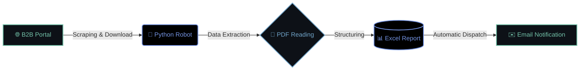

  <picture><source media="(prefers-color-scheme: light)" srcset="assets/banner-en-light.svg"><source media="(prefers-color-scheme: dark)" srcset="assets/banner-en-dark.svg"></picture>

<em>From Operations to Engineering: solving complex problems with technology.</em>

🇧🇷 <a href="README.md">Português</a> &nbsp;·&nbsp; 🇺🇸 <b>English</b>

<a href="https://www.linkedin.com/in/jfrois/"><picture><source media="(prefers-color-scheme: light)" srcset="https://img.shields.io/badge/LinkedIn-f0f3f8?style=for-the-badge&logo=linkedin&logoColor=3f5fb8"><source media="(prefers-color-scheme: dark)" srcset="https://img.shields.io/badge/LinkedIn-000000?style=for-the-badge&logo=linkedin&logoColor=7392E0"></picture></a> <a href="mailto:contatojuanfrois@gmail.com"><picture><source media="(prefers-color-scheme: light)" srcset="https://img.shields.io/badge/Email-f0f3f8?style=for-the-badge&logo=gmail&logoColor=3f5fb8"><source media="(prefers-color-scheme: dark)" srcset="https://img.shields.io/badge/Email-000000?style=for-the-badge&logo=gmail&logoColor=7392E0"></picture></a>

<picture><source media="(prefers-color-scheme: light)" srcset="assets/divider-light.svg"><source media="(prefers-color-scheme: dark)" srcset="assets/divider-dark.svg"></picture>

### 👨‍💻 About me

I've worked at companies like **Loft, QuintoAndar and VOSS Automotive**. That hybrid view of Operations and Technology taught me to spot real bottlenecks and build tools that solve them.

I use **Python** for Automation (RPA) and Data Analysis. My goal is to work in Software Engineering, delivering operational efficiency and strategic value, **not just code**.

### 📈 Impact in numbers

*Active user time: how long the person stays busy. The robot runs on its own afterwards.*

  <picture><source media="(prefers-color-scheme: light)" srcset="assets/metric-processador-en-light.svg"><source media="(prefers-color-scheme: dark)" srcset="assets/metric-processador-en-dark.svg"></picture>
  <picture><source media="(prefers-color-scheme: light)" srcset="assets/metric-totvs-en-light.svg"><source media="(prefers-color-scheme: dark)" srcset="assets/metric-totvs-en-dark.svg"></picture>
  <picture><source media="(prefers-color-scheme: light)" srcset="assets/metric-aftermarket-en-light.svg"><source media="(prefers-color-scheme: dark)" srcset="assets/metric-aftermarket-en-dark.svg"></picture>
  <picture><source media="(prefers-color-scheme: light)" srcset="assets/metric-envio-en-light.svg"><source media="(prefers-color-scheme: dark)" srcset="assets/metric-envio-en-dark.svg"></picture>

<picture><source media="(prefers-color-scheme: light)" srcset="assets/divider-light.svg"><source media="(prefers-color-scheme: dark)" srcset="assets/divider-dark.svg"></picture>

### 🚀 Featured projects

  <a href="https://github.com/JFrois/Analise-Aftermarket"><picture><source media="(prefers-color-scheme: light)" srcset="assets/card-aftermarket-en-light.svg"><source media="(prefers-color-scheme: dark)" srcset="assets/card-aftermarket-en-dark.svg"></picture></a>
  <a href="https://github.com/JFrois/RPA-Processamento_PDFs"><picture><source media="(prefers-color-scheme: light)" srcset="assets/card-processador-en-light.svg"><source media="(prefers-color-scheme: dark)" srcset="assets/card-processador-en-dark.svg"></picture></a>
  <a href="https://github.com/JFrois/Automa-o-de-Cadastro-de-Previs-o-de-Vendas---TOTVS-Protheus"><picture><source media="(prefers-color-scheme: light)" srcset="assets/card-totvs-en-light.svg"><source media="(prefers-color-scheme: dark)" srcset="assets/card-totvs-en-dark.svg"></picture></a>
  <a href="https://github.com/JFrois/Envio-novos-casos---Python"><picture><source media="(prefers-color-scheme: light)" srcset="assets/card-envio-en-light.svg"><source media="(prefers-color-scheme: dark)" srcset="assets/card-envio-en-dark.svg"></picture></a>

<b>⚙️ View the Order Processor architecture</b>

<picture><source media="(prefers-color-scheme: light)" srcset="assets/divider-light.svg"><source media="(prefers-color-scheme: dark)" srcset="assets/divider-dark.svg"></picture>

### 💻 Stack

**Core:**
<picture><source media="(prefers-color-scheme: light)" srcset="https://img.shields.io/badge/Python-f0f3f8?style=for-the-badge&logo=python&logoColor=3f5fb8"><source media="(prefers-color-scheme: dark)" srcset="https://img.shields.io/badge/Python-000000?style=for-the-badge&logo=python&logoColor=7392E0"></picture> <picture><source media="(prefers-color-scheme: light)" srcset="https://img.shields.io/badge/SQL_Server-f0f3f8?style=for-the-badge&logo=microsoftsqlserver&logoColor=3f5fb8"><source media="(prefers-color-scheme: dark)" srcset="https://img.shields.io/badge/SQL_Server-000000?style=for-the-badge&logo=microsoftsqlserver&logoColor=7392E0"></picture> <picture><source media="(prefers-color-scheme: light)" srcset="https://img.shields.io/badge/PostgreSQL-f0f3f8?style=for-the-badge&logo=postgresql&logoColor=3f5fb8"><source media="(prefers-color-scheme: dark)" srcset="https://img.shields.io/badge/PostgreSQL-000000?style=for-the-badge&logo=postgresql&logoColor=7392E0"></picture> <picture><source media="(prefers-color-scheme: light)" srcset="https://img.shields.io/badge/Streamlit-f0f3f8?style=for-the-badge&logo=streamlit&logoColor=3f5fb8"><source media="(prefers-color-scheme: dark)" srcset="https://img.shields.io/badge/Streamlit-000000?style=for-the-badge&logo=streamlit&logoColor=7392E0"></picture> <picture><source media="(prefers-color-scheme: light)" srcset="https://img.shields.io/badge/Selenium-f0f3f8?style=for-the-badge&logo=selenium&logoColor=3f5fb8"><source media="(prefers-color-scheme: dark)" srcset="https://img.shields.io/badge/Selenium-000000?style=for-the-badge&logo=selenium&logoColor=7392E0"></picture> <picture><source media="(prefers-color-scheme: light)" srcset="https://img.shields.io/badge/Power_BI-f0f3f8?style=for-the-badge&logo=powerbi&logoColor=3f5fb8"><source media="(prefers-color-scheme: dark)" srcset="https://img.shields.io/badge/Power_BI-000000?style=for-the-badge&logo=powerbi&logoColor=7392E0"></picture>

**Also use:**
<picture><source media="(prefers-color-scheme: light)" srcset="https://img.shields.io/badge/JavaScript-f0f3f8?style=for-the-badge&logo=javascript&logoColor=3f5fb8"><source media="(prefers-color-scheme: dark)" srcset="https://img.shields.io/badge/JavaScript-000000?style=for-the-badge&logo=javascript&logoColor=7392E0"></picture> <picture><source media="(prefers-color-scheme: light)" srcset="https://img.shields.io/badge/Java-f0f3f8?style=for-the-badge&logo=openjdk&logoColor=3f5fb8"><source media="(prefers-color-scheme: dark)" srcset="https://img.shields.io/badge/Java-000000?style=for-the-badge&logo=openjdk&logoColor=7392E0"></picture> <picture><source media="(prefers-color-scheme: light)" srcset="https://img.shields.io/badge/C-f0f3f8?style=for-the-badge&logo=c&logoColor=3f5fb8"><source media="(prefers-color-scheme: dark)" srcset="https://img.shields.io/badge/C-000000?style=for-the-badge&logo=c&logoColor=7392E0"></picture> <picture><source media="(prefers-color-scheme: light)" srcset="https://img.shields.io/badge/HTML5_%26_CSS3-f0f3f8?style=for-the-badge&logo=html5&logoColor=3f5fb8"><source media="(prefers-color-scheme: dark)" srcset="https://img.shields.io/badge/HTML5_%26_CSS3-000000?style=for-the-badge&logo=html5&logoColor=7392E0"></picture> <picture><source media="(prefers-color-scheme: light)" srcset="https://img.shields.io/badge/MySQL-f0f3f8?style=for-the-badge&logo=mysql&logoColor=3f5fb8"><source media="(prefers-color-scheme: dark)" srcset="https://img.shields.io/badge/MySQL-000000?style=for-the-badge&logo=mysql&logoColor=7392E0"></picture> <picture><source media="(prefers-color-scheme: light)" srcset="https://img.shields.io/badge/Docker-f0f3f8?style=for-the-badge&logo=docker&logoColor=3f5fb8"><source media="(prefers-color-scheme: dark)" srcset="https://img.shields.io/badge/Docker-000000?style=for-the-badge&logo=docker&logoColor=7392E0"></picture> <picture><source media="(prefers-color-scheme: light)" srcset="https://img.shields.io/badge/Git_%26_GitHub-f0f3f8?style=for-the-badge&logo=github&logoColor=3f5fb8"><source media="(prefers-color-scheme: dark)" srcset="https://img.shields.io/badge/Git_%26_GitHub-000000?style=for-the-badge&logo=github&logoColor=7392E0"></picture> <picture><source media="(prefers-color-scheme: light)" srcset="https://img.shields.io/badge/Jira_%26_Confluence-f0f3f8?style=for-the-badge&logo=jira&logoColor=3f5fb8"><source media="(prefers-color-scheme: dark)" srcset="https://img.shields.io/badge/Jira_%26_Confluence-000000?style=for-the-badge&logo=jira&logoColor=7392E0"></picture> <picture><source media="(prefers-color-scheme: light)" srcset="https://img.shields.io/badge/Postman-f0f3f8?style=for-the-badge&logo=postman&logoColor=3f5fb8"><source media="(prefers-color-scheme: dark)" srcset="https://img.shields.io/badge/Postman-000000?style=for-the-badge&logo=postman&logoColor=7392E0"></picture>

<picture><source media="(prefers-color-scheme: light)" srcset="assets/divider-light.svg"><source media="(prefers-color-scheme: dark)" srcset="assets/divider-dark.svg"></picture>

### 📊 GitHub activity

<picture>
  <source media="(prefers-color-scheme: dark)" srcset="https://raw.githubusercontent.com/JFrois/JFrois/output/github-snake-dark.svg">
  <source media="(prefers-color-scheme: light)" srcset="https://raw.githubusercontent.com/JFrois/JFrois/output/github-snake.svg">
  
</picture>

  <picture><source media="(prefers-color-scheme: light)" srcset="https://github-readme-stats.vercel.app/api/top-langs/?username=JFrois&layout=compact&hide_border=true&bg_color=ffffff&title_color=3f5fb8&text_color=57606a"><source media="(prefers-color-scheme: dark)" srcset="https://github-readme-stats.vercel.app/api/top-langs/?username=JFrois&layout=compact&hide_border=true&bg_color=000000&title_color=7392E0&text_color=71A5CA"></picture>

<picture><source media="(prefers-color-scheme: light)" srcset="assets/divider-light.svg"><source media="(prefers-color-scheme: dark)" srcset="assets/divider-dark.svg"></picture>

  <picture><source media="(prefers-color-scheme: light)" srcset="assets/footer-en-light.svg"><source media="(prefers-color-scheme: dark)" srcset="assets/footer-en-dark.svg"></picture>

