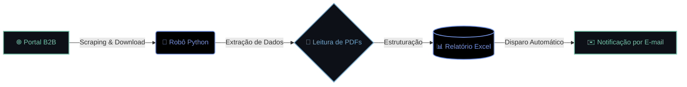

[+que+elimina+trabalho+manual;Dados+e+Python+para+decisões+melhores)](https://github.com/JFrois)

### Desenvolvedor Python | Automação (RPA) | Dados
*Do Operacional à Engenharia: resolvendo problemas complexos com tecnologia.*

🟢 **Aberto a novas oportunidades**

 

---

### 👨‍💻 Sobre mim

Atuei em empresas como **Loft, QuintoAndar e VOSS Automotive** e, com essa visão híbrida entre Operações e Tecnologia, aprendi a identificar gargalos reais e a construir ferramentas que os resolvem.

Uso **Python** para Automação (RPA) e Análise de Dados. Meu objetivo é atuar em Engenharia de Software, entregando eficiência operacional e valor estratégico, **não só código**.

### 📈 Impacto em números

| Métrica | Resultado |
|---|---|
| ⏱️ Tempo economizado | _[ex.: X horas/semana]_ |
| 🤖 Processos automatizados | _[ex.: N fluxos]_ |
| ✅ Redução de erros manuais | _[ex.: X%]_ |

---

### 🚀 Projetos em destaque

| Projeto | Problema | Solução | Stack |
|---|---|---|---|
| 📊 **[Análise Aftermarket](https://github.com/JFrois/Analise-Aftermarket)** | Oportunidades de venda no mercado de reposição não eram visíveis | Aplicação corporativa que cruza dados de clientes OEM e gera leads qualificados (VOSS Automotive) | Python · Streamlit · SQL |
| 🤖 **[Processador de Pedidos (RPA)](https://github.com/JFrois/RPA-Processamento_PDFs)** | Horas de trabalho manual em portais B2B | App desktop que baixa pedidos, lê PDFs, consolida em Excel e notifica por e-mail | Python · Selenium |
| 🏭 **[Cadastro TOTVS Protheus](https://github.com/JFrois/Automa-o-de-Cadastro-de-Previs-o-de-Vendas---TOTVS-Protheus)** | Cadastros complexos e repetitivos no ERP | Bot de RPA que automatiza o cadastro de previsão de vendas | Python · RPA |
| ⚖️ **[Envio de Novos Casos](https://github.com/JFrois/Envio-novos-casos---Python)** | Consolidação e envio manual de dados (ex.: ITBI) | Pipeline Python + Zapier com envio automatizado | Python · Zapier |

<b>⚙️ Ver arquitetura do Processador de Pedidos</b>

---

### 💻 Stack

**Principal:**
     

**Também uso:**
        

---

### 📊 Atividade no GitHub

<picture>
  <source media="(prefers-color-scheme: dark)" srcset="https://raw.githubusercontent.com/JFrois/JFrois/output/github-snake-dark.svg">
  <source media="(prefers-color-scheme: light)" srcset="https://raw.githubusercontent.com/JFrois/JFrois/output/github-snake.svg">
  
</picture>

  

